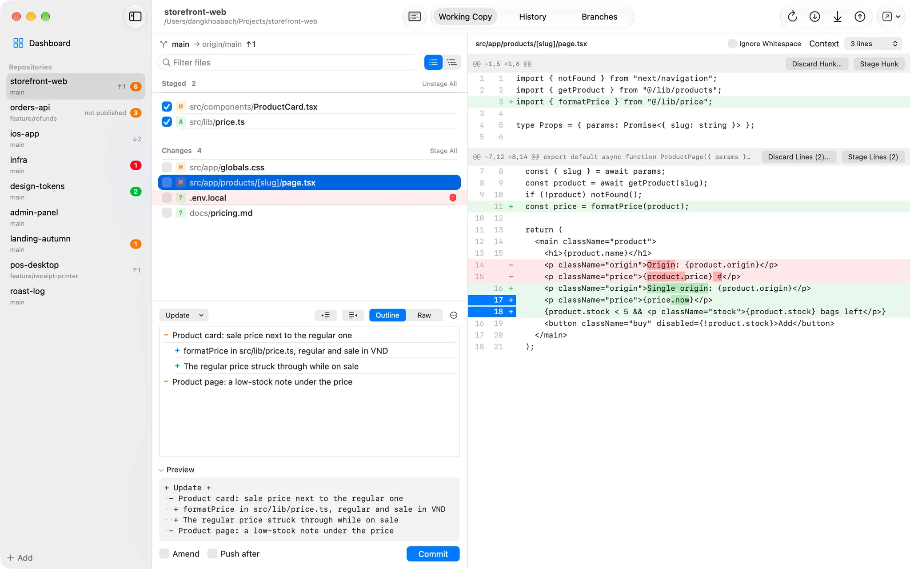
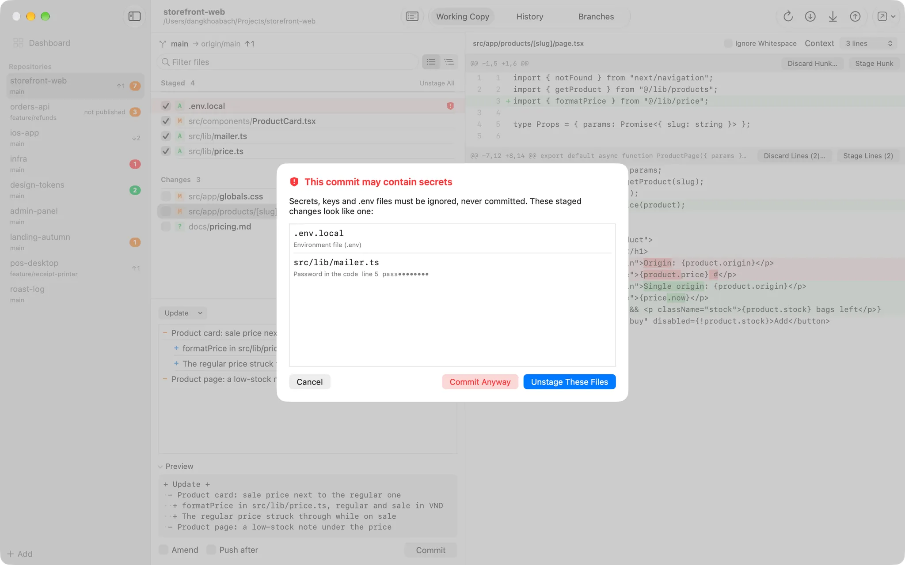
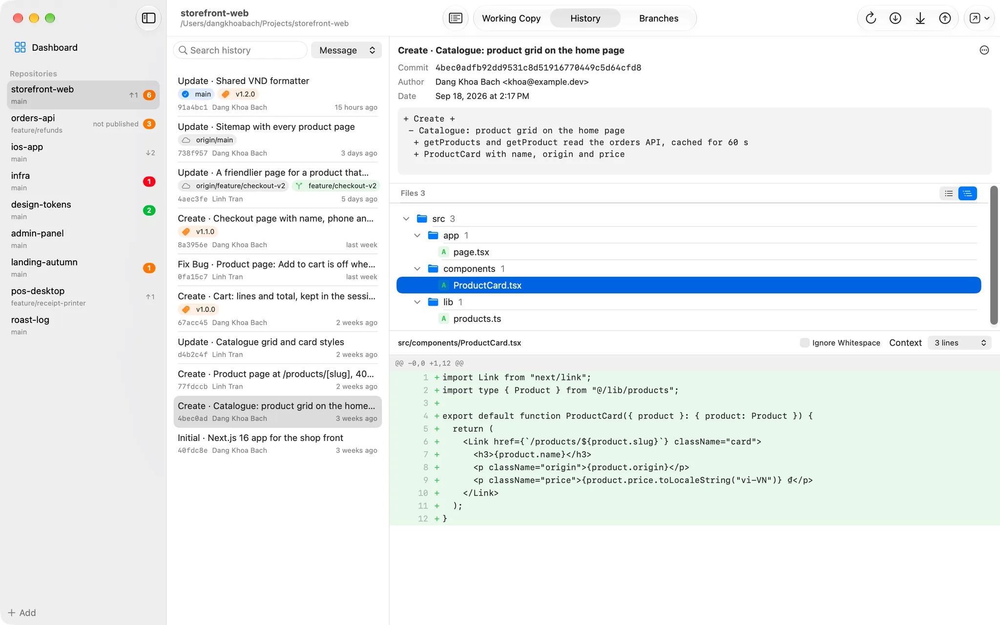
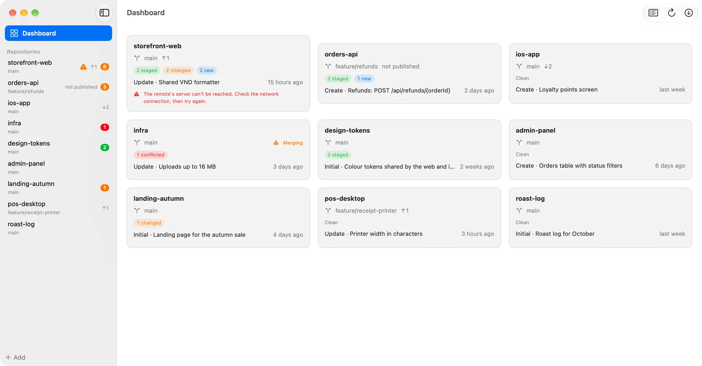

# SourceDeck

A native macOS Git client for daily work, built to replace Sourcetree for
the things it is actually used for: seeing what changed, staging files, hunks
and single lines, reading diffs, committing, pushing and pulling, and reading
history — across every repository at once from one dashboard.

<picture><source media="(prefers-color-scheme: dark)" srcset="docs/screenshots/workingcopy-dark.webp"></picture>

Three things set it apart from a general-purpose client:

- **Commit messages in one house format.** A `+ Keyword +` header, ` - detail`
  lines and `  + sub-detail` lines, with no blank line after the header. The
  composer builds that structure byte for byte, previews exactly what will be
  sent, and refuses a message that breaks the format or carries an AI
  attribution line.
- **A check before every commit.** Staged `.env` files, private keys,
  `Local.xcconfig` and API keys in added lines are listed before the commit
  goes through; unstaging them is the default answer.
- **Every repository on one screen.** Which ones have changes, what is ahead
  or behind, fetch them all with one click.

<picture><source media="(prefers-color-scheme: dark)" srcset="docs/screenshots/sensitive-dark.webp"></picture>

## What it does

- **Avatars** for repositories, round like a contact's: the initials of the
  name on grey, or a picture or logo chosen from the repository's menu in the
  sidebar or on the Dashboard.
- **Dashboard** of every added repository: branch, ahead and behind, staged,
  changed and new files, the last commit; refresh all, fetch all, optional
  automatic fetch. Add a repository by cloning it from a URL, choosing a
  folder, dropping it on the sidebar or scanning a folder for repositories.
- **Working Copy** (⌘1): Staged and Changes lists with a checkbox per file,
  rename and conflict markers, a filter, and files that look like secrets
  tinted red. Shown as a flat list or as a tree of folders that open and
  close, with a checkbox per folder that stages everything under it. The diff
  stages, unstages or discards a whole hunk or only the lines picked in its
  gutter; changed words are marked inside a line; context and whitespace can
  be changed. The list follows changes made in other apps within a second,
  and stays quiet while a build writes into ignored folders.
- **Commit composer**: keyword menu, an outline of details and sub-details
  (⏎ adds one, ⇥ / ⇧⇥ change its level), raw text when preferred, the reason
  Commit is greyed out, amend while the last commit is still local, push after
  commit. Drafts are kept per repository across launches.
- **History** (⌘2): 200 commits at a time, refs by kind, search by message,
  author or path, each commit's files (list or tree) and diff, copy SHA or
  message, open on GitHub, reuse a message. A graph of branches and merges
  beside the commits. Any branch's history, every branch's at once, or one
  file's, followed through renames. A commit's menu checks it out, branches
  or tags it, cherry-picks it from another branch, reverts it (staged, with
  the message finished in the composer) or resets the branch to it (Soft,
  Mixed, or Hard after stashing every change). A file's menu shows its
  history, its blame, or that version compared with the working copy,
  opened, saved or restored.
- **Branches** (⌘3): switch (stashing changes first when asked), create from
  HEAD, merge into the current branch (a fast-forward when possible,
  otherwise staged for the composer), rename, delete merged branches; stash,
  look inside a stash, apply, pop and drop; tags made, pushed and deleted.
- **Fetch, Pull, Push** with git's own output in a log (⌥⌘L) and a one-line
  explanation of each failure. A branch that was never published asks before
  its first push. Pull and Push show how many commits they would bring or
  send. The repository on screen fetches in the background when it is opened
  or the app comes back to the front and its last fetch is over 5 minutes
  old; when that was is shown above the files and on the Dashboard. Behind
  its upstream, the branch's History lists the commits a pull would bring,
  marked ↓.
- **Sign In** when an HTTPS remote wants an account: push, pull, fetch or
  clone asks for a username and a password or access token, hands them to
  git's credential helper (the Keychain), and runs again. A wrong password is
  asked for again; Fetch All and the automatic fetch never ask, and one
  sign-in fetches the other repositories waiting on the same host.
  **Settings › Accounts** lists the HTTPS hosts of your repositories, who is
  signed in to each, with Sign In and Sign Out.
- English and Vietnamese, light and dark.

<picture><source media="(prefers-color-scheme: dark)" srcset="docs/screenshots/history-dark.webp"></picture>

**Not here, on purpose:** rebase and a conflict editor. A
merge, cherry-pick, revert or rebase in progress is shown with an Abort button
and a way to open the repository in Sourcetree; Open In also offers Finder,
Terminal and the installed editors.

## Safety

- Nothing is thrown away without a confirmation that names the files.
  Untracked and newly added files that are discarded go to the Trash.
- No force push, no `git clean`, no `branch -D`. A hard reset only comes from
  Reset to Here › Hard, asked twice, with every change stashed first. The app
  never edits `.gitconfig` and never commits, pushes or creates a branch on its
  own; a revert or merge it starts waits for the composer's commit.
- Hooks run on every commit (`--no-verify` is never used).
- git never prompts: missing credentials fail at once with git's own message,
  and the app asks instead (HTTPS). The account goes to git's own credential
  helper on its stdin, the way Terminal saves one; the app keeps no copy and
  never logs the password. SSH keys and passphrases stay with ssh and its agent.
- A lock left by another git process is waited out once (300 ms) before it is
  reported.

## Keyboard

| Keys | Action |
|---|---|
| ⌘0 · ⌘1 · ⌘2 · ⌘3 | Dashboard · Working Copy · History · Branches |
| ⌘R | Refresh |
| ⇧⌘F · ⇧⌘L · ⇧⌘P | Fetch · Pull · Push |
| ⌘⏎ · ⇧⌘⏎ | Commit · Commit and push |
| Space | Stage or unstage the selected files |
| ⌘⌫ | Discard the selected files (asks first) |
| ⌘F | Filter files, or search history |
| ⌘N · ⌘O · ⇧⌘O | Clone a repository · Add a repository · Scan a folder |
| ⌥⌘L | Show or hide the git output |

## How it works

The app runs the `git` already on the Mac (`/usr/bin/git`, changeable in
Settings) and parses its machine-readable output; it does not embed its own
Git. Your `.gitconfig`, global ignore file, hooks and credential helper
(`osxkeychain`) apply exactly as they do in Terminal. Hooks get the `PATH` of
your login shell, so a hook that runs `node` from nvm works.

Measured on the development Mac (Apple M3 Pro): status, a page of history and a 5,000-line diff of
`swift-nio` (3,082 commits) each take under 45 ms; a clean `xcodebuild` inside
the open repository costs the app 0.3 % CPU on average.

<picture><source media="(prefers-color-scheme: dark)" srcset="docs/screenshots/dashboard-dark.webp"></picture>

## Requirements

- macOS 14+.
- git 2.30 or later — the one that comes with Xcode or the Command Line Tools
  (`xcode-select --install`) is fine.

## Install

Download the latest version from
[apps.dangkhoabach.vn/dkb-source-control](https://apps.dangkhoabach.vn/dkb-source-control).

The app is signed with a self-signed certificate, not an Apple Developer ID, so macOS blocks
the first launch. Open it once from **System Settings → Privacy & Security → Open Anyway**.
Updates then arrive through **Check for Updates…** ([Sparkle](https://sparkle-project.org/),
signed with EdDSA).

SourceDeck was called DKB Source Control up to version 1.0.4. It is the same app with the same
bundle identifier, so an installed copy keeps its repository list, drafts and updates.

## Build from source

Requirements: Xcode 26 or later.

```bash
cp Local.xcconfig.example Local.xcconfig   # ad-hoc signing, enough to build and run
./scripts/create-signing-cert.sh           # or: a stable self-signed identity
open SourceDeck.xcodeproj
```

Swift 6 / SwiftUI. The `.xcodeproj` is committed (`project.pbxproj` and the
shared scheme); the app and test folders are synchronized groups, so new
source files need no project edit. `Local.xcconfig` — gitignored, just
`CODE_SIGN_IDENTITY` — is the project's base configuration, so the build fails
until that file exists. The self-signed certificate keeps the app's identity
stable across builds, which keeps a macOS folder-access grant (for a
repository on the Desktop or in Documents) from being asked again after every
rebuild.

`SourceDeckCore` is a headless Swift package (git process runner,
parsers, patch building, commit message rules, GRDB storage). Both test
suites run on throwaway repositories with the real git — nothing is mocked:

```bash
cd SourceDeckCore && swift test                                        # 183 tests
xcodebuild -project SourceDeck.xcodeproj -scheme SourceDeckApp test    # 37 tests
```

The only third-party dependency is [GRDB](https://github.com/groue/GRDB.swift),
for the list of added repositories and the commit drafts.

## Releasing

`./scripts/release.sh <version>` tests, builds a signed universal app, a DMG
and its Sparkle signature into `release-output/`; the DMG is published
through admin.dangkhoabach.vn, and the installed app finds it with Check for
Updates… (once a day if allowed). `./scripts/install-local.sh` installs a
build into `/Applications`. See [`docs/release.md`](docs/release.md).

## Forking

Change these before you ship your own build, so it neither replaces itself with the official
release nor shares its data:

- `PRODUCT_BUNDLE_IDENTIFIER` in the Xcode project.
- `SUFeedURL` and `SUPublicEDKey` in `SourceDeckApp/Info.plist` (generate your own key with
  Sparkle's `generate_keys`).

## Security

Please report vulnerabilities privately, as described in [SECURITY.md](SECURITY.md).

## Contributing

Issues are welcome. This is a personal project, so pull requests are read but may not be
merged.

## License

[MIT](LICENSE) for the source code. The SourceDeck name, app icon and logo are not covered by
the license; use your own for a fork.
